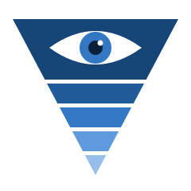

  

# Paranoid TypeScript

A standard for building robust, very strict TypeScript applications, and for testing, shipping and
deploying them. It is written for projects where most or all of the code is written by an AI coding
agent, and for the people who direct those agents.

## Why it exists

An agent can write more code in an afternoon than a team can review in a week. Review still finds
real defects, but it finds them late, at the most expensive point, and only while the reviewer is
paying attention. Every defect a review finds of a kind a compiler or a linter could have refused
is a control at the wrong level.

So this standard pushes every check it can down to the machine: compiler flags, type-aware lint
rules, schemas at every boundary, tests that cannot reach production, gates that refuse to ship a
tree nobody checked. What remains — what a SQL statement does, which lock a transaction takes,
whether a business rule is the right rule — stays with tests against real systems and with review,
which now has the time for it.

One measured finding shapes the whole standard. When the strictness path in [09
Adoption](standards/09-adoption.md) was run on real services, every behavioural defect it surfaced
came from a review or a test, and none was a type error. The compiler's job is to make a defect
expressible and enforceable once found, and to keep whole classes from recurring. The reviews and
tests are not optional extras around the type system; they are half of the method.

## The ladder

Every rule names its rung on the [Hierarchy of Defect
Controls](https://github.com/odclcslkrpb5k/hierarchy-of-defect-controls), an adaptation to software
of the occupational-safety Hierarchy of Controls (NIOSH). Highest first:

| Rung | Meaning | Example |
|---|---|---|
| **Eliminate** | the mistake can no longer exist | remove the feature, the dependency, the mechanism |
| **Substitute** | a tool makes the mistake much harder | a vetted library, `bigint` for 64-bit ids |
| **Engineer** | the mistake is possible and something catches it | a type, a lint rule, a CI gate, a DB constraint |
| **Administer** | people are asked not to make it | review, a checklist, this document |
| **Protect** | it ships and the damage is absorbed | alerts, rollback, backups |

A rule enforced only by Administer is a request to remember. Its `Enforced by` line names the
Engineer control that is missing, so the next project can build it.

### Layers count only when they are independent

The standard stacks its controls — compiler, lint, boundary parsing, typed errors, tests, review —
in the manner of defense in depth, where no one layer is trusted to catch everything. The idea has
a caveat that matters more for agent-written code than for any other kind: two layers count as two
only if they cannot fail for the same reason. A test an agent writes from its own reading of a
problem shares the agent's misreading, so it is not independent of the code it tests. That is why
the standard leans on machine checks the agent did not write (chapters 02 and 03), on tests
measured by putting bugs back (TS-5), on fixtures recorded from real systems (TS-11), and on
reviewers briefed separately from the author (SH-4).

## The chapters

| File | Prefix | Covers |
|---|---|---|
| [01 Toolchain](standards/01-toolchain.md) | `TC` | runtime, dependencies, formatting, the one check command |
| [02 Compiler](standards/02-compiler.md) | `CP` | `tsconfig` settings beyond `strict` |
| [03 Lint](standards/03-lint.md) | `LN` | type-aware lint, escape hatches, suppressions |
| [04 Errors](standards/04-errors.md) | `ER` | errors as values, adapters, catch-alls, panics |
| [05 Boundaries](standards/05-boundaries.md) | `BD` | parsing outside data, coercions, branded ids, time |
| [06 Code](standards/06-code.md) | `CD` | comments, side effects, source hygiene |
| [07 Testing](standards/07-testing.md) | `TS` | what a test may touch, and what the suite must prove |
| [08 Repository](standards/08-repository.md) | `RP` | the files every repository has, vendored code |
| [09 Adoption](standards/09-adoption.md) | `AD` | reaching the level on an existing codebase: the path and the ratchet |
| [10 Shipping](standards/10-shipping.md) | `SH` | the ship cycle, review, the gate, shell scripts |
| [11 Data protection](standards/11-data-protection.md) | `DP` | secrets and sensitive data |
| [12 Services](standards/12-services.md) | `SV` | long-running services and the systems they call |
| [13 Databases](standards/13-databases.md) | `DB` | collation, keys, migrations, cursors |
| [14 SQL](standards/14-sql.md) | `SQ` | functions, triggers, casts, nulls (Postgres) |
| [15 Deployment](standards/15-deployment.md) | `DE` | one tested way: containers on hosts you run |
| [16 Credentials](standards/16-credentials.md) | `CR` | how a service proves who it is |
| [17 Agents](standards/17-agents.md) | `AG` | hazards specific to AI agents, and several agents working together |

Chapters 01 to 09 are the TypeScript core and apply to any project. Chapters 10 to 17 apply when a
project has the thing they describe: a service, a database, a deployment of its own. Chapter 15 in
particular describes one way of deploying that has been used in production and works well. It is
not the only way, and a project that deploys differently takes its principles, not its commands.

[`examples/`](examples/) holds reference implementations of many rules, held to the standard
themselves, with tests; a rule that has one links to it in an `Example:` line. They show one way to
meet a rule, not the only one.

## Appendices

[`appendices/`](appendices/) carries the core into other languages and frameworks, one file each:

- [Paranoid Python (Django)](appendices/python-django.md)
- [Paranoid C (GTK 3)](appendices/c-gtk.md), for Linux desktop applications

An appendix defines no rules of its own. It cites the core rules it serves and says, for each, what
meets it in that language, where the language leaves a gap, and where a framework forces a
deviation, with its reason. A hazard the core's language cannot have, such as memory safety in C,
gets a section of its own, judged on the same ladder. A core rule an appendix does not mention
applies as written. Each names
the tool versions its settings were checked against.

## Reading a rule

    ### TC-3 (MUST) One sentence stating the rule.
    The detail.

    **Why:** what goes wrong without it, ideally what did go wrong.

    **Enforced by:** its rung, and the mechanism. For Administer, the Engineer control missing.

    **Prior art:** the existing standard or idea it matches or comes from, when there is one.

- **Levels** are [RFC 2119](https://www.rfc-editor.org/rfc/rfc2119): **MUST** / **MUST NOT** hold
  unless the project's owner says otherwise and the project records it; **SHOULD** has exceptions,
  which the project records with its reason; **MAY** is a permitted practice.
- **Proposed.** Most rules were learned in production projects. A rule marked **(PROPOSED)** has
  not yet been proven in one: it is a reasoned addition waiting for its first project.
- **IDs are permanent.** A rule that stops applying is marked `RETIRED` with the date and reason,
  and its ID is never reused. Within a chapter, rules are grouped by topic, not by number.

## Words used here

- **The level**, or **the full level**: every MUST and SHOULD in chapters 02 to 05 in force.
- **Ship**: the cycle that takes a change from a working tree to the main branch (chapter 10).
- **Gate**: the script that runs every check before a commit is allowed, and judges each by its
  exit status (SH-10, SH-11).
- **Harvest**: the step of a ship that decides what goes into the project's notes (SH-5).
- **Brief**: the instructions a review agent is given; different briefs find different defects
  (SH-4).
- **Skill**: a packaged instruction set an agent loads for a task (Claude Code's term); a "ship
  skill" runs the ship cycle.
- **Adapter** and **port**: from ports and adapters (hexagonal architecture). A port is a boundary
  the program calls through; an adapter is the one module that talks to the foreign code behind it
  (ER-3).
- **Member path**: the dotted path of a field in a structured value, such as `order.customer.id`.
- **Baseline** and **burning down**: the recorded set of existing violations a check tolerates, and
  removing them until the record is empty (AD-2).
- **Shadow mode**: running a new service beside the one it replaces, doing every read and recording
  every write without making it (SV-6).

## Using it in a project

A project under this standard needs one thing installed on the machine that works on it: Docker.
Everything else — the runtime, tools and dependencies, each at an exact version — is defined in the
project's `Dockerfile` and compose file (TC-9).

A project's `CLAUDE.md` (or equivalent agent instructions) links to this standard, names the commit
it last conformed to, and lists its deviations, each with its reason. It links to rules rather than
copying them: copies drift, and drifted copies of the same rules across several repositories are
part of why a central standard exists.

## Prior art

Much of this standard matches or descends from existing work, and readers may find the originals
useful. Each rule's `Prior art` line names its own; the main ones are:

- **The Hierarchy of Controls** (NIOSH, occupational safety), via the Hierarchy of Defect Controls.
- **typescript-eslint's `strict-type-checked` configuration**, which chapter 03 adopts whole.
- **"Parse, don't validate"** (Alexis King, 2019): chapter 05's boundary rules.
- **Rust's `Result`, `#[must_use]` and `panic!`**, and TypeScript libraries in that style such as
  neverthrow: chapter 04.
- **Nominal or "newtype" types** (Haskell, Rust), expressed in TypeScript as branded types.
- **RFC 2119** for requirement levels.
- **Mutation testing** (PIT, Stryker): chapter 07 applies it selectively, to regression tests and
  to the tests of checkers.
- **The Twelve-Factor App** for configuration from the environment, which chapter 12 tightens:
  parsed and refused at boot.
- **Martin Kleppmann's fencing tokens** ("How to do distributed locking", 2016) for leases.
- **Expand/contract ("parallel change") migrations** for rollback-safe schema changes.
- **Google's SRE books** on alerting: one incident is one alert.
- **GitHub's Scientist** and dark launching, for shadow mode.
- **Deno's test sanitizers**, which fail a test that leaks a timer or a connection.

From domain modelling and functional programming:

- **"Make illegal states unrepresentable"** (Yaron Minsky): exhaustive unions (LN-3), branded ids
  (BD-5) and the ban on escape hatches all make the type checker refuse states the program must
  never be in.
- **Primitive obsession and value objects** (Domain-Driven Design): branded ids (BD-5).
- **Railway-oriented programming** (Scott Wlaschin): `Result` and its handling (chapter 04).
- **The anti-corruption layer** (Eric Evans, Domain-Driven Design): adapters (ER-3), which keep
  foreign code's exceptions and shapes from leaking inward.
- **Poka-yoke** (mistake-proofing, Shigeo Shingo) and **fail-fast design**: refusing bad input at
  the boundary and bad configuration at boot (BD-1, SV-1).

From safety-critical and industrial engineering. These standards govern systems where a defect can
kill, and the parallels are structural rather than claims of equivalence: nothing here makes a
TypeScript service certifiable under any of them.

- **MISRA C and C++**: a language restricted to a safer subset, with rules graded Mandatory,
  Required and Advisory. Chapters 02 and 03 subset TypeScript the same way, graded MUST, SHOULD and
  MAY.
- **IEC 61508** (functional safety): recommends strongly typed languages, language subsets and
  static analysis, more strongly the higher the required safety integrity level.
- **DO-178C** (airborne software): independence of verification from development, the reason for
  separately briefed reviewers (SH-4). Its structural coverage criterion (MC/DC) measures what
  tests execute; mutation testing (TS-5) measures what they would catch.
- **HAZOP** (hazard and operability study): its guide words — no, more, less, part of, other than,
  reverse — make a useful checklist for reviewing a boundary parser (BD-1): a missing member, a
  value out of range, an unknown enumeration value.
- **STPA** (Nancy Leveson): an unsafe control action is one given too early, too late, or stopped
  too soon. ER-10's audit of aborts asks the same of a run cut short.
- **ISA-18.2 / IEC 62682** (alarm management for the process industries): every alarm actionable,
  no alarm floods, alarms rationalized. SV-11 to SV-13 apply the same discipline to alerts.
- **Defense in depth** (IAEA INSAG-10): independent layers of protection; see "Layers count only
  when they are independent" above.

From security:

- **The OWASP Logging Cheat Sheet**: what must never be logged (DP-3), and log injection.
- **The TC39 Type Annotations proposal**: the direction of travel that makes erasable-only
  TypeScript (TC-2) a safe bet.

## Status

Started 2026-10-14. The standard is deliberately mutable: it changes as projects built under it
find holes, edge cases and rules that were wrong. Git history is its changelog.

## License

The standard's text is licensed under [Creative Commons Attribution 4.0
International](LICENSE) (CC BY 4.0): share and adapt it, with attribution. The code in
[`examples/`](examples/) is licensed under the [MIT License](examples/LICENSE), so it can be copied
into a project without the attribution requirements of the prose license.
